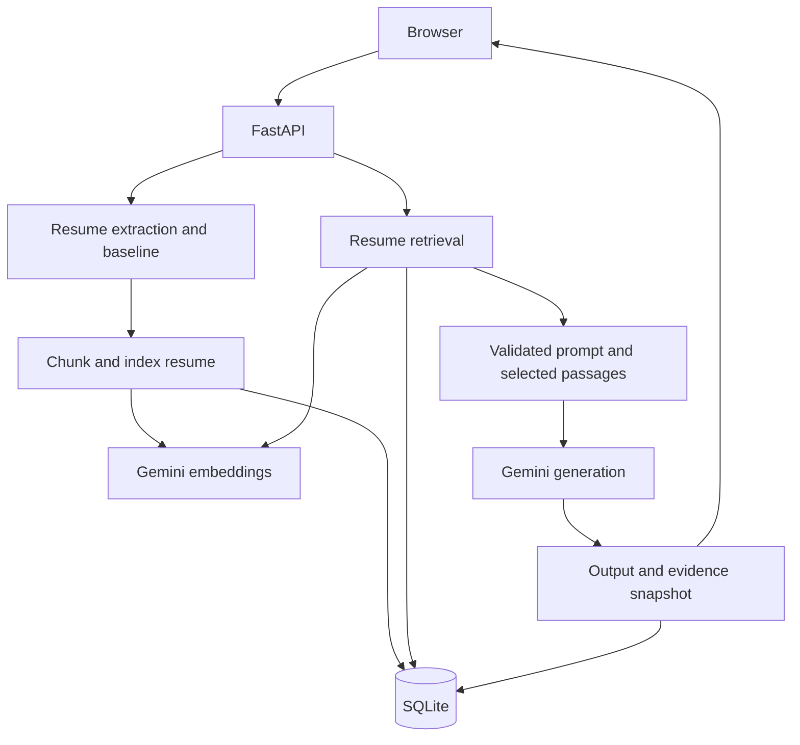

# Mandatory resume RAG architecture

The browser talks to FastAPI on the same origin. SQLite persists local application state; Gemini is the external embedding and generation service.

## Save and retrieve

PDF, DOCX and TXT uploads are extracted without retaining binaries. Saving an analysis prepares resume embeddings before opening a write transaction. The analysis and complete index are then committed together. Identical resume content and settings reuse persisted vectors; a new analysis still owns its own document/chunk records. Index failures leave no new analysis. Existing analyses without an index are upgraded lazily on retrieval.

Each resume is split into at most 80 chunks of 1,500 characters with 200-character overlap. Gemini creates 768-dimensional vectors using RETRIEVAL_DOCUMENT; normalized vectors are stored as JSON. A custom evidence question, or the first 1,000 characters of role plus job description, uses RETRIEVAL_QUERY. Query vectors are cached per analysis/query/settings with a maximum of 100 cached questions.

Retrieval scans only documents of kind `resume` belonging to the current analysis. Positive cosine matches are sorted and the top 1–8 are selected (default five). Gemini receives those passages as candidate evidence, not the full resume. A zero-match result explicitly says evidence is insufficient. Source IDs identify document and chunk; original PDF page positions are not retained after editable resume text is saved.

## Prompt and history

Five validated variables support immutable template versions. The required resume_text variable receives selected passages, while extracted_skills is recalculated from those passages. Resume content is never interpreted as template code. Server-side instructions treat all source content as untrusted data and require evidence citations. Checks detect missing or unknown source IDs, not factual entailment.

Comparisons retrieve once, generate twice using the same snapshot, and save both runs atomically. An error on the second provider call leaves no partial pair, though the first call may have incurred charges. Feedback is manual. The UI renders output through textContent.

## Tables

| Table | Data |
|---|---|
| templates | Reusable task identity |
| versions | Immutable prompt revisions and notes |
| analyses | Saved resume, job, role and local baseline report |
| rag_documents | Resume fingerprint and embedding settings per analysis |
| rag_chunks | Passage text, position and vector |
| rag_queries | Cached query vector scoped by analysis and settings |
| runs | Exact prompt/output, retrieval snapshot, model, settings and feedback |

Deleting an analysis cascades to its runs, documents, chunks and query cache. Replacing an index after model/settings changes is atomic; a failed refresh preserves the old index and stops generation. Old supporting documents are ignored by new retrieval. Historical runs are preserved with their exact snapshots. Old offline runs remain readable but no new API run may use offline mode or disable RAG.

## Separate evidence view and readable outputs

The sidebar's RAG & chunks view follows Prompt studio. It contains stored chunk inspection, retrieval settings and previews, and the selected run's evidence snapshot. Prompt studio retains its editor/output layout. Stored chunk reads are scoped to one analysis and exclude vector values and legacy supporting documents; reading them causes no provider request. `app/static/output.js` formats valid JSON responses as labelled text/bullets for single, comparison and history outputs, while preserving the exact response in storage and exports. Display uses textContent, so source text and output cannot insert executable HTML.
